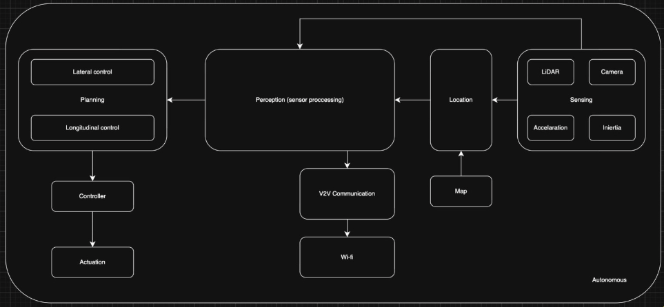
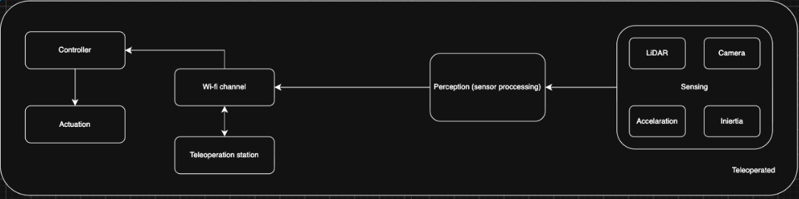
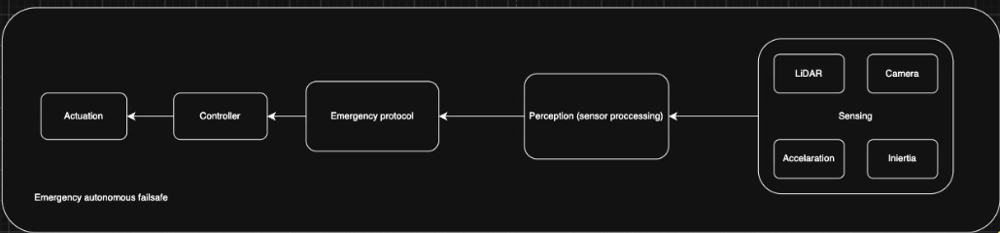

**Status:** Done · **Due:** _13/10/2026_
## Presentation
<iframe
  src={require('@site/static/pdf/Presentation-MS2.pdf').default}
  title="Legal requirments and "
  style={{width: '100%', height: '600px', border: 'none', borderRadius: '8px'}}
/>

## Introduction
In this document we will show the architecture, the requirments we gathered, the Personas and the User stories. For the personas e user stories as you will see, despite our project is an experiment and it can be use in many fiels, we choose to focus more on the fiel that will be certainly more widely applied, logistics.

## Architeture
### Autonomous

### Teleoperated

### Emergency autonomous failsafe

## Requirments

### Functional 
| Requirment | Description 
|---|---
| RF1 | The leader must be capable of being remotely teleoperated from a remote station.
| RF2 | The system must allow switching between autonomous and teleoperated modes in real time.
| RF3 | The leader must autonomously follow the predefined route.
| RF4 | All followers must operate autonomously.
| RF5 | The system must allow a route to be defined for the leader.
| RF6 | The vehicles must continuously exchange V2V messages containing position, speed, acceleration, and manoeuvre intentions.
| RF7 | The followers must replicate the leader's trajectory (lateral error ≤ to be defined).
| RF8 | The followers must replicate the leader's speed profile and maintain the inter-vehicle distance (the required braking distance must be 20% shorter than this distance).
| RF9 | The followers must combine V2V information with onboard sensor data.
| RF10 | Sudden braking by the leader must be broadcast via V2V and trigger the coordinated stopping of the entire platoon without collisions.
| RF11 | The system must detect an obstacle or hazard in the middle of the platoon and split it into two groups.
| RF12 | After the split, the second group must stop safely.
| RF13 | A remote operator must be able to take over the leadership of the second group, with the remaining robots switching to following it.

### Non-Functional
| Requirment | Description 
|---|---
| RNF01 | The system must ensure that the delay between sending and receiving a V2V message does not exceed 100 ms.
| RNF02 | Following an emergency braking warning, each follower must respond and perform emergency braking within a maximum of 100 ms.
| RNF03 | The system must ensure that, in the event of a loss of communication with the leader, the vehicles enter a safe state and do not cause collisions.
| RNF04 | V2V messages must include mechanisms to identify outdated or duplicated messages to prevent operational issues.
| RNF05 | The system must enforce a maximum distance between the leader and the followers.
| RNF06 | The vehicles must be able to use their sensors to correctly estimate the position, speed, acceleration, and manoeuvre intentions of other vehicles.
| RNF07 | The system must support continuous platoon operation throughout the planned tests without unexplained failures.
| RNF08 | The components must be compatible with ROS 2, Ubuntu, and the LIMO PRO software.
| RNF09 | The system must provide information about vehicle status to the control centre and server for diagnostics, and display sensor data.
| RNF10 | After recovering from a communication problem, the system must automatically resume the route in an organised manner.

## Actors 
* Remote driver
* Robot
* Follower robot
* Leader robot

## User stories
| User story | Description
|---|---
| US1 | As the remote driver, I want to be able to switch between tele-operated and autonomous driving for any robot so that I can guarantee the security of the trip and intervene as needed in difficult situations
| US2 | As the remote driver, I want to be able to see the current state, sensor data and parameters of any robot so that I can ensure an informed and safe experience while driving remotely
| US3 | As the robot, I want to be able to assume both the leader and follower role so that I can lead a sub-platoon in case the original platoon splits  
| US4 | As a follower robot, I want to be able to know the state of the other robots in my platoon so that I can accompany the flow of the other platoon members, breaking not to crash or filling blank spaces in case the others leave the platoon
| US5 | As the leader robot, I want to be able to follow a specified path, always following the highway code so that I can travel safely without hitting objects and leaving the limit lines 
| US6 | As a follower robot, I want to be able to get to know the leader broke so that I can do a security hard brake on time before hitting one of the other robots  
| US7 | As a follower robot, I want to be able to detect a platoon split in front of me so that I can temporarily assume the leadership of my sub-platoon to make us stop safely 
| US8 | As a robot, I want to be able to know if both teleoperation and autonomous driving modes are down so that I can safely stop on the right of the road and wait for future instructions and interventions
| US9 | As a robot, I want to be able to map the environment I'm in so that I can locate myself and the other robots in it and drive in a smart and strategical way, avoiding to hit any objects or other robots

