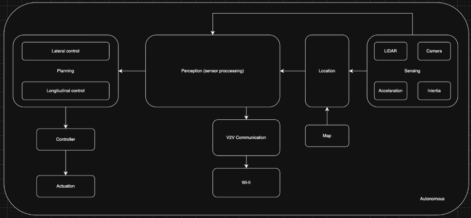
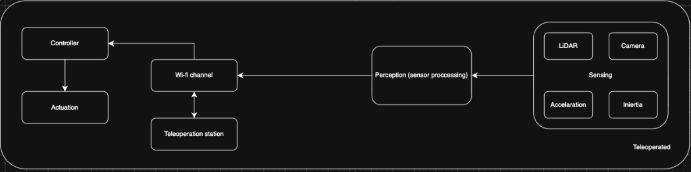
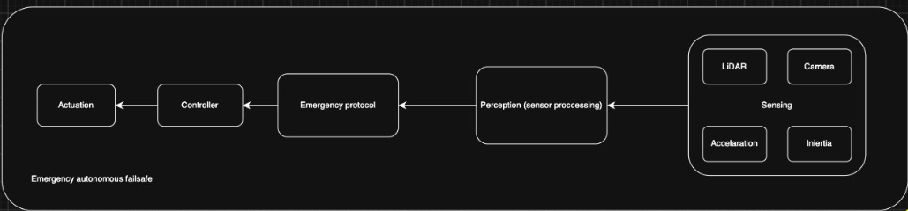

**Status:** In progress · **Due:** _dd/mm/yyyy_

## Introduction
In this document we will show the architecture, the requirments we gathered, the Personas and the User stories. For the personas e user stories as you will see, despite our project is an experiment and it can be use in many fiels, we choose to focus more on the fiel that will be certainly more widely applied, logistics.

## Architeture
### Autonomous

### Teleoperated

### Emergency autonomous failsafe

## Requirments

### Functional 
| Requirment | Description 
|---|---
| RF1 | The leader must be capable of being remotely teleoperated from a remote station.
| RF2 | The system must allow switching between autonomous and teleoperated modes in real time.
| RF3 | The leader must autonomously follow the predefined route.
| RF4 | All followers must operate autonomously.
| RF5 | The system must allow a route to be defined for the leader.
| RF6 | The vehicles must continuously exchange V2V messages containing position, speed, acceleration, and manoeuvre intentions.
| RF7 | The followers must replicate the leader's trajectory (lateral error ≤ to be defined).
| RF8 | The followers must replicate the leader's speed profile and maintain the inter-vehicle distance (the required braking distance must be 20% shorter than this distance).
| RF9 | The followers must combine V2V information with onboard sensor data.
| RF10 | Sudden braking by the leader must be broadcast via V2V and trigger the coordinated stopping of the entire platoon without collisions.
| RF11 | The system must detect an obstacle or hazard in the middle of the platoon and split it into two groups.
| RF12 | After the split, the second group must stop safely.
| RF13 | A remote operator must be able to take over the leadership of the second group, with the remaining robots switching to following it.

### Non-Functional
| Requirment | Description 
|---|---
| RNF01 | The system must ensure that the delay between sending and receiving a V2V message does not exceed 100 ms.
| RNF02 | Following an emergency braking warning, each follower must respond and perform emergency braking within a maximum of 100 ms.
| RNF03 | The system must ensure that, in the event of a loss of communication with the leader, the vehicles enter a safe state and do not cause collisions.
| RNF04 | V2V messages must include mechanisms to identify outdated or duplicated messages to prevent operational issues.
| RNF05 | The system must enforce a maximum distance between the leader and the followers.
| RNF06 | The vehicles must be able to use their sensors to correctly estimate the position, speed, acceleration, and manoeuvre intentions of other vehicles.
| RNF07 | The system must support continuous platoon operation throughout the planned tests without unexplained failures.
| RNF08 | The components must be compatible with ROS 2, Ubuntu, and the LIMO PRO software.
| RNF09 | The system must provide information about vehicle status to the control centre and server for diagnostics, and display sensor data.
| RNF10 | After recovering from a communication problem, the system must automatically resume the route in an organised manner.

## Actors 
* Remote driver
* Fleet manager

## Personas
### Remote Driver
João, 35 years old, a former heavy goods vehicle driver. He is accustomed to driving trucks but not to complex interfaces, and he is easily distracted by information unrelated to driving. He places great importance on safety.

Goals:

* Drive the leader safely.

* React quickly to unexpected situations, such as the platoon splitting.

Frustrations:

* Overloaded screens that distract him from the road.

* Delays between issuing a command and the vehicle's response.

Needs:

* A simple interface centred on the camera feed, with overlaid speed, operating mode, and alerts.

* Minimal latency between the command and the vehicle's response.

* A clear alert when the platoon splits and the ability to take over the leadership of the subgroup.

### Fleet Manager
Paulo, 49 years old, with 24 years of experience as a fleet manager at a logistics company. He plans routes and coordinates drivers before each trip. He is meticulous and requires every driver to report the status of the journey regularly.

Goals:

* Ensure that journeys proceed safely and according to plan.

* Maintain continuous visibility of the platoon's status.

Frustrations:

* Only finding out about unexpected events halfway through the route when the driver calls, often too late.

* Frequent reports distracting drivers from the road.

Needs:

* Define the platoon's route in advance.

* Monitor the location and status of each vehicle in real time.

* Receive alerts about safety events (sudden braking, platoon splitting).

* Assign a remote driver to the subgroup following a split.

* Reduce dependence on drivers, with fully autonomous followers and only one remote driver when necessary.

## User stories
| User story | Description
|---|---
| US1 | As a remote driver, I want minimal latency between the command and the vehicle so that I can react quickly to dangerous situations on the road.
| US2 | As a remote driver, I want to receive alerts when dangerous situations occur, such as the platoon splitting or sudden braking, so that I can react quickly without having to search for the information on the screen.
| US3 | As a remote driver, I want to see the leader's camera feed in real time so that I can drive with the same level of perception I would have inside a vehicle.
| US4 | As a remote driver, I want to be able to switch between autonomous and remote driving of the leader so that I only need to intervene when the route requires decisions the system cannot make.
| US5 | As a remote driver, I want to take over the leadership of the subgroup that has stopped following a platoon split so that the group can resume its journey safely.
| US6 | As a fleet manager, I want to define the platoon's route in advance so that I can prevent potential problems along the route.
| US7 | As a fleet manager, I want to monitor the location and status of each vehicle in real time so that I do not depend on human reports to track the journey.
| US8 | As a fleet manager, I want to receive alerts about safety events so that I can make decisions quickly.
| US9 | As a fleet manager, I want to assign a remote driver to lead the subgroup after a split so that the journey can resume quickly and safely.

